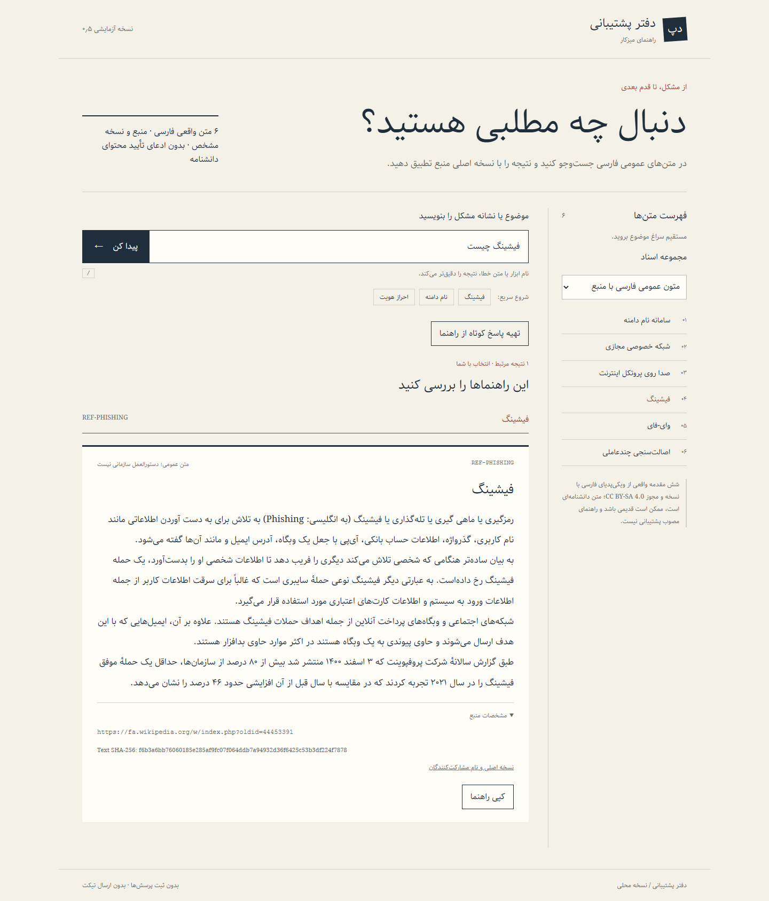
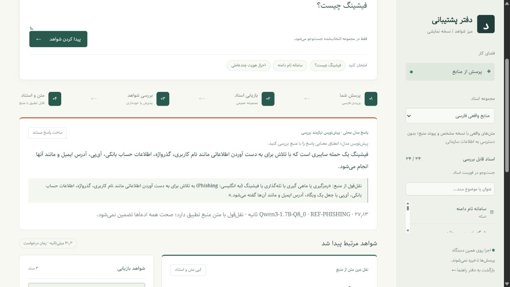

# دفتر پشتیبانی

A Persian support handbook: find a runbook, inspect its source, and prepare a support ticket when the issue remains unresolved.

**v0.6 — 34 attributed Persian references, verified import receipts and a graphical evidence desk.** The 12 public runbooks are synthetic examples, not an organization's approved procedures. Questions are not stored and ticket drafts are not submitted.

[Verified v0.5 CI](https://github.com/saintedwind/persian-it-evidence/actions/runs/38568779781) · [Current validation](reports/VALIDATION_V05.md) · [Earlier acceptance evidence](reports/RELEASE_CHECKS.md) · [Desktop](reports/handbook-desktop.png) · [Mobile](reports/handbook-mobile.png)



## Run

### Graphical demo

Optional local synthesis is now available through `run_with_answer.py`: retrieve a source, then click **ساخت پاسخ مستند**. The verified Qwen3-1.7B Q8_0 model writes a Persian draft with a source-exact quote; the original source remains visible. No paid API is used. See [setup, real inference evidence and limitations](reports/LOCAL_SYNTHESIS.md). Quote matching does not verify all generated claims.

After starting the server, open **http://127.0.0.1:8765/demo** for the graphical evidence desk: real Persian reference texts, ranked sources, source receipts and explicit abstention. On Windows, `run-visual-demo.ps1` starts the same server. It uses the existing retrieval engine rather than canned responses. See [verification and screenshots](reports/VISUAL_DEMO.md).

Requires Python 3.11+, with no package installation or service credentials.

```sh
python server.py
# Open http://127.0.0.1:8765
python -m unittest discover -s tests -v
python evaluate.py --check
```

## Reliability in v0.4

- Cancelled or late drafts cannot overwrite a newly selected guide or edited question.
- Closing and reopening a ticket preserves edits in the same workflow; navigation starts a new context.
- JSON requests are accepted only from local hosts and permitted browser origins. This is a local request boundary, not organizational authentication.
- The model launcher refuses occupied ports and supports graceful automation shutdown with `--stop-file PATH`. In-flight request threads cannot block application exit.
- Actual Windows CPU start, one inference and stop-file shutdown passed on 13 October: 2.34 seconds for the inference and both ports released. See `reports/lifecycle-v04.json`.

## What changed

- Browse a public guide directory and open documents directly.
- Search in Persian, inspect ranked results, and select a source text.
- Copy a guide with its identifier or prepare an editable ticket with problem, device, error, reproduction steps and guide consulted.
- Keyboard navigation, a search shortcut, request timeout, and protection against stale search responses.
- An ink-and-paper layout using the locally bundled Gandom typeface. Font copyright and license are preserved in `web/Gandom-LICENSE.txt`; upstream: https://github.com/rastikerdar/gandom-font.

## Retrieval and access

Persian normalization and tokenization feed a BM25 ranker. A fixed lexical-coverage heuristic determines whether to show a result. Text is displayed verbatim; relevance is not a guarantee that a procedure solves the issue.

Public access is enforced before scoring and before building the directory. The browser cannot request a staff role. The CLI's `--scope staff` is a trusted local test switch, not authentication.

| Endpoint | Behavior |
|---|---|
| `GET /health` | Process health |
| `GET /api/documents` | Public directory |
| `GET /api/documents?id=IT-004` | Public document, or 404 for absent/restricted IDs |
| `POST /api/ask` | JSON containing `question` and optional `collection` (`sample` or `reference`); ranked excerpts and status |
| `POST /api/draft` | Explicit optional local sentence selection; bounded question and output |
| `POST /api/answer` | Optional local Persian synthesis with source ID and checked exact quotation; up to 400 question characters |

The browser creates ticket drafts locally. Clipboard permission depends on the browser; text remains selectable when automatic copying is unavailable.

## Validation

The v0.5 suite contains 53 unit/API tests, all passing locally on 14 October 2026. Tests cover input validation, public-only access, source-exact selection, malformed/truncated model output, concurrency and regression-gate failures. Model calls in unit tests are mocked. Actual inference evidence is recorded separately below. A separate Chromium acceptance workflow checks guide loading, source lookup, editable tickets, delayed drafts, errors and the 390px layout. Its model responses are mocked; screenshots are retained as the handbook-browser-evidence Actions artifact. Check the latest successful run before relying on this workflow.

The unchanged 24-question synthetic benchmark contains 18 answerable and 6 unanswerable cases:

| Metric | Result |
|---|---:|
| Recall@3 on answerable questions | 16/18 = 88.9% |
| MRR@3 | 0.889 |
| Correct source or abstention | 22/24 = 91.7% |
| Abstention on unanswerable questions | 6/6 |

See `reports/evaluation.json` and `reports/FAILURE_ANALYSIS.md`. These author-written smoke tests are not an independent holdout or a production accuracy estimate. Two paraphrase failures remain; interface changes do not improve the retrieval score.

The regression gate now preserves each of the 22 previously passing cases, including all six abstentions. Known failures remain in the dataset and may improve. An aggregate score cannot hide a newly broken case.

## Review the implementation

- [Case study: workflow, decisions and measured results](reports/CASE_STUDY.md)
- [Operator notes: start, troubleshoot, test and hand off](reports/OPERATIONS.md)
- [Known retrieval failures](reports/FAILURE_ANALYSIS.md)

## Limits

The sample corpus has 12 public examples and one synthetic restricted fixture; a separate collection contains 34 attributed Persian encyclopedia introductions. Indirect wording can fail; topic words can also retrieve an irrelevant procedure. There is no organization login, ingestion workflow, document approval, editing service or ticket-system integration. The standard-library HTTP server binds to loopback and is intended for local use, not public deployment. No customer adoption or savings are claimed.

Maintained by Peyman Gholamhosseini. Independent project; not an Azarab product or deployment.


## Version 0.5: what is measured

The default remains dependency-free lexical search. A separate, opt-in CPU multilingual retriever rescues some lexical abstentions; it does not generate text. Existing lexical accepted decisions are preserved, except that opaque letter/digit identifiers must actually exist in the selected public source. A narrow missing-facet guard screens monetary requests and credential/contact requests. These guards are not a general semantic or security guarantee.

| Frozen question group | Lexical | Optional multilingual |
|---|---:|---:|
| Original synthetic smoke cases | 22/24 | 22/24 |
| Additional Persian transfer cases | 24/48 | 40/48 |
| Six real Persian introductions | 34/36 | 35/36 |

The 24 development questions select similarity 0.40 and runner-up margin 0.08. These are heuristics, not probabilities. The 48-case set was inspected during guard development and is now a **regression/transfer set, not a blind holdout**. No independent reviewer or customer traffic was used. A wrong reference source (VPN question → Wi-Fi article) and the two original paraphrase failures remain. Historical unsuccessful iterations are retained in reports. See [full experiment and limitations](reports/VALIDATION_V05.md).

Actual loopback HTTP with the real model reproduced 22/24, 40/48 and 35/36; every returned source-text hash, character bound and public scope was reconciled. Browser checks additionally verify collection changes, revision links, source receipts and the 390px reference layout.

### Run the optional experiment

Python 3.12+; approximately 252 MB of pinned, SHA-256-verified model/tokenizer files. No paid API, login, query upload or automatic import-time download.

```powershell
python -m pip install -r requirements-semantic.txt
python prepare_semantic.py
python evaluate_semantic.py
python live_semantic.py
$env:HANDBOOK_RETRIEVER = 'hybrid'
python server.py
```

Without `HANDBOOK_RETRIEVER=hybrid`, search uses the lexical baseline. Hybrid startup fails explicitly if its model or dependencies are missing. The base application and unit suite do not require these packages. The pinned quantized model is [Qdrant's ONNX conversion](https://huggingface.co/Qdrant/paraphrase-multilingual-MiniLM-L12-v2-onnx-Q) of Sentence Transformers multilingual MiniLM, Apache-2.0; revision and weight digests live in semantic.py. CPU only, two inference threads, 128-token truncation and full-source verbatim display. Long reference passages can lose ranking information beyond that input limit.

### Real texts, separate from example runbooks

Choose **متون عمومی فارسی با منبع** in the directory. Six unchanged MediaWiki introduction extracts are attributed to Persian Wikipedia contributors under CC BY-SA 4.0, with revision/history links, retrieval timestamp and exact byte digests in [the manifest](data/reference-manifest.json). These are encyclopedic references, potentially outdated, **not approved troubleshooting procedures**. [Attribution and reuse notice](data/PERSIAN_REFERENCE_NOTICE.md). The application reads the checked-in snapshots offline and fails closed on digest/inventory mismatch. Reference text licensing is separate from application code licensing.

Each displayed source has a UTF-8 text SHA-256 receipt; this identifies the stored text, not factual authority. The public corpus fingerprint excludes restricted documents. Collection selection cannot select a staff role. No new organization access control, PDF/OCR ingestion, policy version resolution or customer deployment is claimed.

## Optional local model (v0.3 experiment)

A real Qwen3-0.6B-Q8_0 model runs through llama.cpp on CPU. No paid API, key, or cloud inference is used. Download the official [model](https://huggingface.co/Qwen/Qwen3-0.6B-GGUF/tree/23749fefcc72300e3a2ad315e1317431b06b590a) (~640 MB) and [Windows CPU runtime b11476](https://github.com/ggml-org/llama.cpp/releases/tag/b11476), then run:

```sh
python run_local.py --runtime /path/to/llama-server.exe --model /path/to/Qwen3-0.6B-Q8_0.gguf
```

The application is at http://127.0.0.1:8765. The new button explicitly requests a source-based draft. Ordinary search never calls the model. Ctrl+C stops both processes. For scripted review, provide `--stop-file /path/to/new-marker` and create that marker to request shutdown; an existing marker is rejected. Plain `python server.py` retains the original search-only mode. Model files are excluded from Git.

The small model's free-form Persian output was unreliable in initial trials. The implemented mode asks it to select numbered source sentences, then renders those sentences verbatim in source order. This is real language-model inference for selection, not free-form answer generation. Selection may still be incomplete or irrelevant; consult the full source.

Limits: 400-character question, one public source up to 1,800 characters, 2,048-token runtime context, 96 output tokens, one inference at a time, 90-second timeout, no automatic retries. Invalid source IDs, sentence indices, duplicate selections and truncated outputs produce no draft. Unknown questions skip inference. The endpoint is fixed to loopback and bypasses proxy settings.

See `reports/local-model-smoke.json` for actual inference results and `reports/LOCAL_MODEL.md` for limitations. Earlier free-form failures remain in separate reports. No organization data was used. Model license: Apache-2.0; runtime license: MIT, retained with their distributions. Download bandwidth, disk, RAM and electricity are still required.

## Expanded reference collection

The local v0.6 collection contains 34 actual Persian reference introductions across six topic categories, with 28 raw API receipts and preserved original source bytes. Source-exact validation and live HTTP checks passed. See [scope, ingestion, development results and remaining coverage gaps](reports/REFERENCE_EXPANSION_V2.md). Source and recorded evidence are included in this repository.

## Local synthesis release checks

66 unit/API tests passed locally. Actual Qwen3-1.7B CPU inference produced three Persian drafts and two pre-inference abstentions. The browser verified the explicit generation button, returned quote and source ID. Model weights are deliberately excluded; the launcher verifies the documented official weight checksum. See [real inference results and limitations](reports/LOCAL_SYNTHESIS.md).


